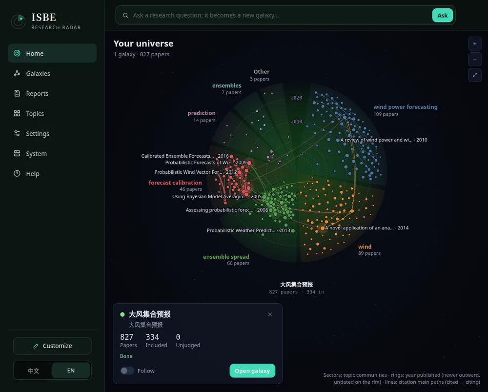
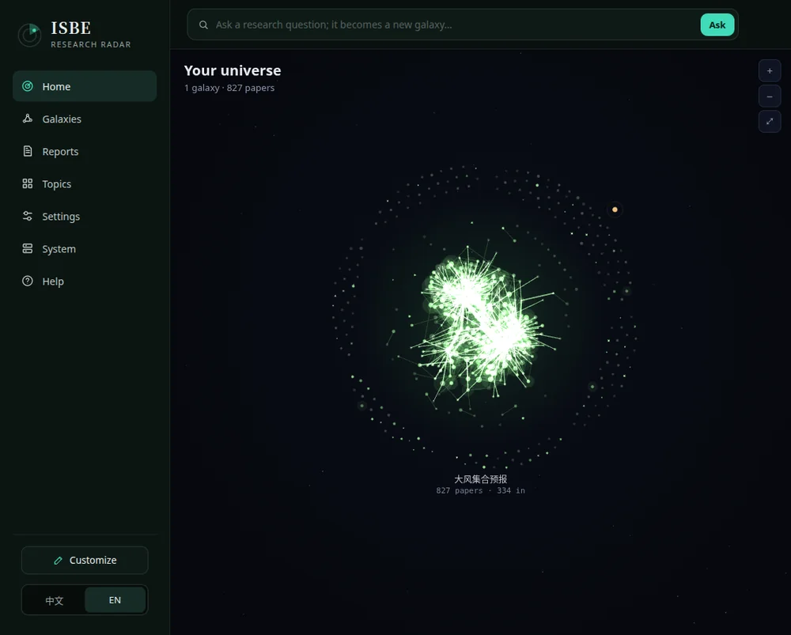
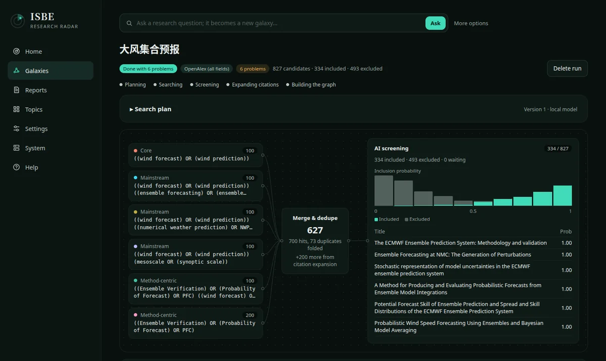
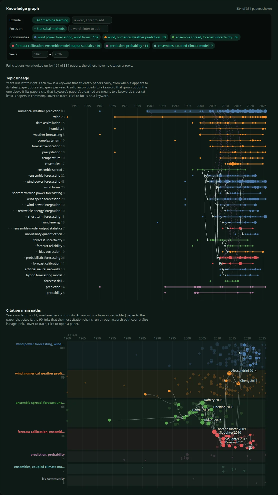
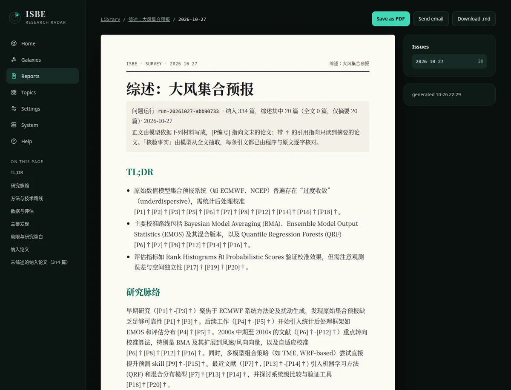

# ISBE — research radar

> Information System with Backbone of Evolution

[](LICENSE)
[](https://www.python.org/)
[](https://nodejs.org/)
[](https://react.dev/)
[](https://github.com/guliqianxun/ISBE)

[中文](README.md) | **English**

ISBE is a self-hosted research tool. Ask it a research question and it writes a
search plan, finds the papers, has a model screen each one, follows their
citations, and draws the result as a galaxy you can actually read: which topics
there are, when each one grew, and which papers form the citation backbone. The
earlier features (daily and weekly paper digests, RSS and GitHub tracking,
fixed-material research reports) still work. It is one Python service, one
SQLite database and a local data directory. Early-stage.

## A quick look

Every screenshot comes from one real run: the question 「大风集合预报」 (wind
ensemble forecasting). Searching OpenAlex and following citations gave 827
candidates; the model kept 334, built a knowledge graph from them, and wrote a
survey report.

**The selected galaxy**: each sector is a topic community, the rings are
publication years (newer further out), and the lines are the main citation
paths.



**Your universe**: Home draws every question as a galaxy; click one to zoom in
on its topics and citations.



**One run, step by step**: the search plan becomes a few query groups, the
results are merged and deduplicated, and the model screens them. The page
shows the spread of inclusion probabilities and the verdict for each paper.



**Knowledge graph**: topics laid out over the years, and main citation paths in
one lane per community. You can exclude or keep only some kinds of method (for
example "no AI methods, statistical methods only"), filter by community and
year, and download the paper set and the graph.



**Survey report**: the included papers are written up as a survey in which
every citation names its source. It goes to the Library, where you can save it
as PDF, download the Markdown or send it by email.



The interface is in English here (中文 / EN toggle at the bottom of the
sidebar); the question, and so the survey, were written in Chinese.

## Quick start

You need Python 3.14, [uv](https://docs.astral.sh/uv/), Node.js 22+ (to build
the frontend) and a working LLM API. Question research searches the
[OpenAlex API](https://openalex.org) directly, with nothing to host; add a free
OpenAlex API key in Settings (without one you share a small daily budget with
everyone on your IP). A self-hosted essaies, which passes queries on to OpenAlex
and keeps a local arXiv index, can be used instead (`ISBE_PAPER_SOURCE`,
`ESSAIES_URL`; see [configuration](docs/configuration.md)). Paper topics
collect from the public arXiv API.

```bash
npm --prefix frontend ci && npm --prefix frontend run build
uv run isbe --data data init
uv run isbe --data data serve
```

Open <http://127.0.0.1:8080> and fill in the model service and key under
Settings, or fill everything in at once with "Import JSON…" (or
`uv run isbe --data data settings import file.json`; see
[examples/settings.example.json](examples/settings.example.json)). Then type a
research question into the box on Home. When the run is done,
`uv run isbe --data data question-survey <run ID>` writes the survey.

Docker works too, see [Docker deployment](docs/deployment.md).

## Documentation

Pages marked (Chinese) are written in Chinese.

| Page | Covers |
| --- | --- |
| [Features](docs/features.md) (Chinese) | what is supported and what is not yet |
| [Getting started in detail](docs/getting-started.md) (Chinese) | the first paper digest, the task queue, common problems |
| [Configuration](docs/configuration.md) (Chinese) | model services, environment variables, mail, full-text extraction, keys and shared login |
| [Settings import/export](docs/settings.md) | set up an install from one JSON file |
| [Topics, scheduling and sources](docs/topics.md) (Chinese) | paper topics, external scheduling, RSS / website sources and the material inbox |
| [Question runs](docs/question/api.md) · [Survey reports](docs/question/survey.md) | the question API, its event stream, and surveys |
| [Fixed-material research and briefings](docs/research.md) (Chinese) | research from fixed sources, media material and edited briefings |
| [Commands](docs/commands.md) (Chinese) | every `isbe` command |
| [Docker, upgrades and backups](docs/deployment.md) (Chinese) | the image, upgrade steps, the data directory and backups |
| [Development](docs/development.md) (Chinese) | tests, frontend development and contributing |

The full index, including the design, architecture and process documents, is
[docs/README.md](docs/README.md).

Released under the [MIT License](LICENSE).
