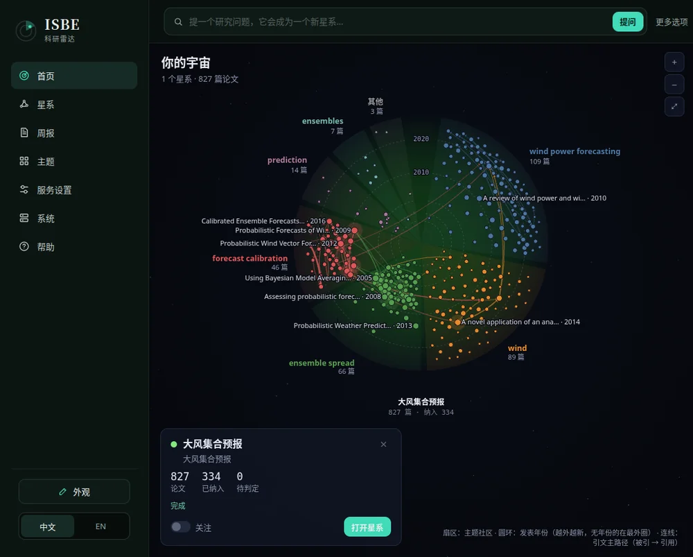
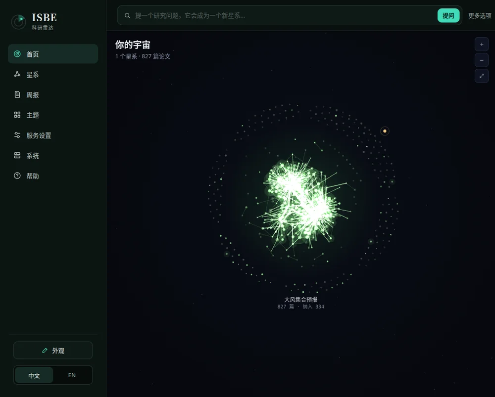
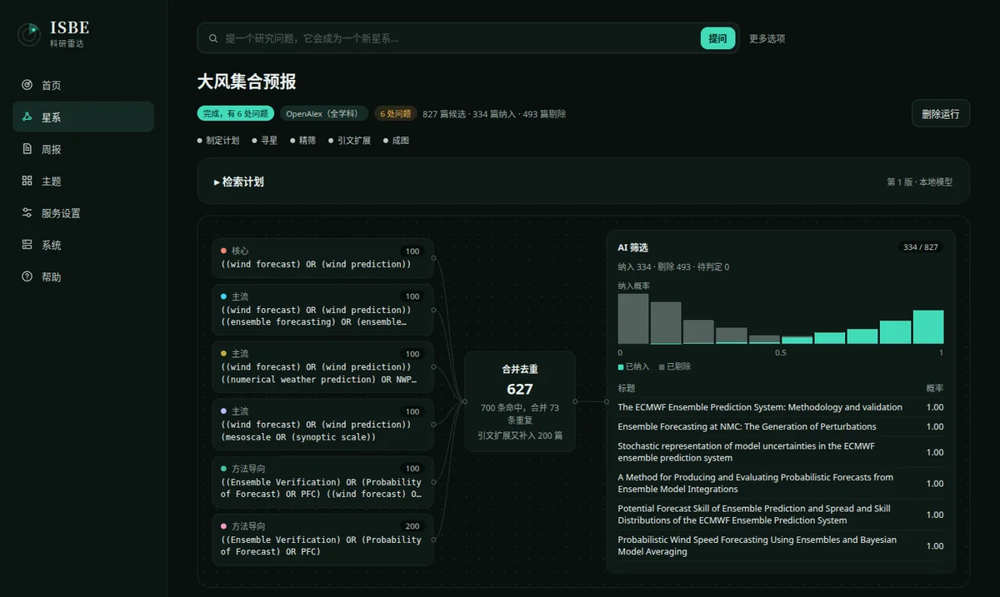
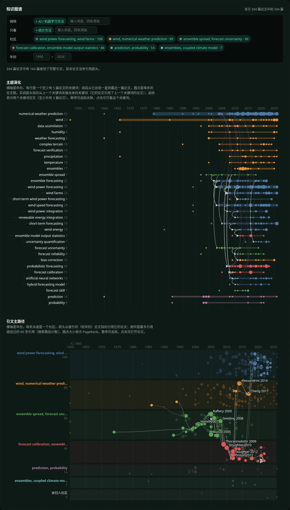
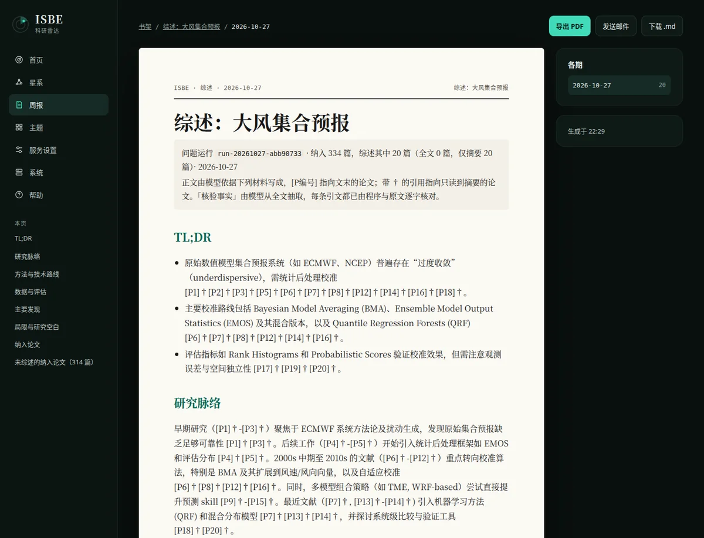

# ISBE — 科研雷达

> Information System with Backbone of Evolution

[](LICENSE)
[](https://www.python.org/)
[](https://nodejs.org/)
[](https://react.dev/)
[](https://github.com/guliqianxun/ISBE)

**中文** | [English](README.en.md)

ISBE 是一个自托管的科研工具。提一个研究问题，它会生成检索方案、检索论文、由模型逐篇筛选、沿引文扩展，并把结果画成一个可以读懂的星系：有哪些主题、各自从哪年发展起来、哪些论文是引文主干。论文主题的日报/周报、RSS 与 GitHub 动态跟踪、固定材料专题研究等原有功能照常可用。一个 Python 服务、一个 SQLite 数据库和一个本地数据目录，目前仍处于早期阶段。

## 看一看

以下截图都来自一次真实运行：问题「大风集合预报」，经 OpenAlex 检索并沿引文扩展得到 827 篇候选，模型筛入 334 篇，建成知识图谱，再写成综述报告。

**选中的星系**：每个扇区是一个主题社区，圆环是发表年份（越外越新），连线是引文主路径。



**你的宇宙**：首页把每个问题画成一个星系，点一下就能放大看它的主题和引文。



**一次运行的过程**：检索方案拆成几组查询，合并去重后交给模型筛选，纳入概率的分布和逐篇结果一目了然。



**知识图谱**：主题演化按年份展开，引文主路径按社区分泳道；可以排除或只看某类方法（例如「排除 AI 方法、只看统计方法」），按社区和年份筛选，并下载论文集与图谱。



**综述报告**：从纳入的论文写成综述，每条引用都标明出处；进入报告书架，可导出 PDF、Markdown 或发邮件。



## 快速开始

需要 Python 3.14、[uv](https://docs.astral.sh/uv/) 和 Node.js 22+（构建前端），以及一个可用的 LLM API。问题研究默认直接检索 [OpenAlex API](https://openalex.org)，无需自建服务；建议在设置页填一个免费的 OpenAlex API Key（不填时与同一 IP 共用很小的每日额度）。也可以改用自托管的 essaies（`ISBE_PAPER_SOURCE`、`ESSAIES_URL`，见[服务配置](docs/configuration.md)）。

```bash
npm --prefix frontend ci && npm --prefix frontend run build
uv run isbe --data data init
uv run isbe --data data serve
```

打开 <http://127.0.0.1:8080>，在「服务设置」里填写模型服务与密钥；也可以点「导入 JSON…」一次填好（或 `uv run isbe --data data settings import 文件.json`，示例见 [examples/settings.example.json](examples/settings.example.json)）。然后在首页的提问框输入一个研究问题，运行完成后用 `uv run isbe --data data question-survey <运行 ID>` 写成综述。

只用 Docker 也可以，见 [Docker 部署](docs/deployment.md)。

## 文档

| 文档 | 内容 |
| --- | --- |
| [功能与状态](docs/features.md) | 已支持与尚未实现的功能 |
| [快速开始（详细）](docs/getting-started.md) | 第一份论文周报、任务队列、常见问题 |
| [服务配置](docs/configuration.md) | 模型服务、环境变量、邮件投递、全文抽取、密钥与共享登录 |
| [设置导入/导出](docs/settings.md) | 用一个 JSON 文件初始化设置（英文） |
| [主题、调度与来源](docs/topics.md) | 论文主题、外部调度、RSS／网页来源与材料收件箱 |
| [问题研究](docs/question/api.md) · [综述报告](docs/question/survey.md) | 问题运行的 API、事件流与综述（英文） |
| [专题研究与行业周报](docs/research.md) | 固定材料专题研究、媒体材料与编辑稿周报 |
| [命令](docs/commands.md) | 全部 `isbe` 命令 |
| [Docker 部署、升级与备份](docs/deployment.md) | 镜像、升级步骤、数据目录与备份 |
| [开发与贡献](docs/development.md) | 测试、前端开发与贡献方式 |

完整索引（含设计、架构与流程文档）见 [docs/README.md](docs/README.md)。

采用 [MIT License](LICENSE)。
