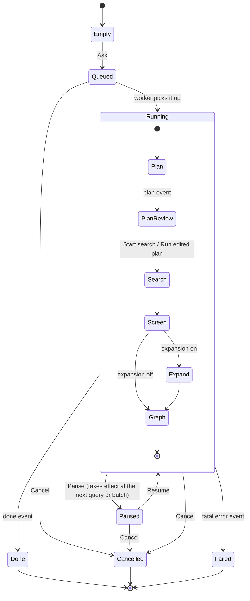

# Question runs: interaction flow and states

Status: agreed on 2026-10-22. This document specifies what a person does, what
ISBE does and what the screen shows during a question run, from typing a
research question to exporting the default knowledge graph. The visual
language of the star map (colors, sizes, timings) is in
[star-map.md](star-map.md); the data contracts (`question_plan@1`,
`paper_set@1`, `screen_verdict@1`, `question_event@1`, `question_graph@1`)
are in [`docs/contracts/question/`](../contracts/question/); the routes, the
event stream and the queue that carry them are in [api.md](api.md).

Three principles decide every case below:

1. **Model-driven.** The plan and the screening are done by the model. A run
   that nobody touches goes from question to graph on its own.
2. **People can overrule.** Every model decision can be overridden, and a
   human override always wins over a later model verdict.
3. **The process is visible.** Every paper on the map can answer "why am I
   here": which query found it, what the model said, who changed it.

## 1. Stages

| Stage | ISBE does | The person can | The screen shows |
| --- | --- | --- | --- |
| Ask | — | Type a question; optionally set a year range and the language the plan and the screening reasons are written in (the console's language by default) | An empty night sky with the question box |
| Plan | The model writes a rewrite and the question's concepts with their terms; ISBE composes a narrow and a broad tier of queries from them for the search engine (`question_plan@1`) | Read it, then **Start search**, or edit it and **Run edited plan**: under review nothing starts by itself (asked without review, the search starts at once); edit it later and rerun | The plan card; each query is drawn as a "star track" (an arc on the map) |
| Search | Runs the queries against essaies, narrow tier first, then the broad tier (deeper pages) unless the narrow one already found 1,500 papers; 1,500–2,500 candidates is normal; each hit is pushed as an event | Watch; pause; cancel | Each new paper lights up as a star on its query's track; a repeat hit brightens the same star instead of adding one |
| Screen | The filter stage: the model judges every candidate in batches against the plan's include/exclude criteria, so the broad tier's noise is screened out rather than searched away | Click any star and override it at any time | Included stars stay bright; excluded stars dim and sink (they stay on the map and can be restored) |
| Expand | Adds one hop of references and citations of included papers, then screens them the same way | Turn expansion off before or during this stage (it is on by default and adds at most 200 candidates per run) | New stars split off next to the included paper they came from |
| Graph | Builds the keyword + citation graph, communities and metrics (`question_graph@1`) | Browse, filter, override, export | The constellation forms: communities gather and take their colors, citation and keyword lines appear |

Search, screening and expansion overlap in time: screening starts as soon as
the first batch of candidates is ready, so the person sees stars light up and
settle at once. The `stage` shown in the run header is the earliest stage
that still has work queued.

In the stage list each stage reads not started, in progress, done, skipped
or **stopped**: when a run fails or is cancelled, a stage still in progress
turns to stopped (a red bar, and the word for screen readers), so a failed
run never shows a stage still at work.

## 2. Run states

A run has one **status** and, while running, one current **stage**. Partial
failure is not a status of its own: it is a flag (`degraded`) that any status
can carry, because one failed query or batch should never stop the rest of
the run.

| Status | Meaning | Ends when |
| --- | --- | --- |
| Empty | No run on the page yet (question page, or a run page whose first event has not arrived) | The person asks |
| Queued | Accepted and waiting for the single worker | The worker starts it, or the person cancels |
| Running | Working through the stages | `done`, a fatal `error`, or cancel |
| Paused | The worker finished the query or batch in hand and stopped; nothing is lost | Resume or cancel |
| Cancelled | Stopped by the person; everything already found, judged and built is kept and viewable | Final (rerun starts a new run) |
| Failed | A fatal error: essaies unreachable at the start, no usable plan, or the database refused writes | Final (rerun starts a new run) |
| Done | The last stage (the graph) ended | Final; overrides and exports still work |

`degraded` is set by the first non-fatal `error` event: a query that failed
after retries, a screening batch the model could not answer, or an
expansion lookup that failed. The run header shows a warning chip with the
count, and the chip opens the list of failures with a **Retry** button for
each. The run still reaches `Done`; the final state then reads "Done with
problems".

A failed screening batch never drops papers. Its papers keep the
**unscreened** verdict and are treated as included for the graph (recall
first), marked so that the person can see the model never judged them.

### 2.1 Events behind the states

Every state change on the page is caused by a `question_event@1` event
(see the [event contract](../contracts/question/)); the page never infers a state from timing.

| Event type | What it changes on the page |
| --- | --- |
| `state` | Run status: `queued`, `running`, `paused`, `cancelled`, `failed`, `done` |
| `stage` | A stage (`plan`, `search`, `screen`, `expand`, `graph`) reaches `begin`, `end` or `skipped` (expansion turned off) |
| `plan` | The plan card fills in and waits for Start search (or is shown as already started when the run was asked without review) |
| `hit` | A star lights up (`new: true`), or a known star brightens (`new: false`, a repeat hit); carries the query id, rank and paper |
| `dedup` | Two stars merge into one (identity key matched after the fact); the merged star keeps both provenance entries |
| `verdict` | A star turns included, excluded or unscreened; carries the reason |
| `override` | A star's state changes because a person overrode it, or reverted an override (a new record with no decision that `revokes` the earlier one) |
| `expand` | A candidate star splits off its parent paper |
| `citations` | More citation edges between the stars are known; the map fetches them again (`GET …/citations`) and draws the strong-gravity links and main routes |
| `graph` | The graph snapshot arrives; the constellation transition starts |
| `error` | Sets `degraded` (`fatal: false`) or leads to `Failed` (`fatal: true`); carries the stage and the failed query, batch or paper key |
| `done` | Final status (`completed`, `partial` = "Done with problems", `cancelled`, `failed`) and counts; export becomes available |

`state` and `stage` are needed in addition to the other event types so that
pause, resume, cancel and stage changes are driven by events too. The page
must be fully rebuilt from the event log alone: opening an old run replays
its events from sequence 1, and reconnecting resumes from the last sequence
seen (`Last-Event-ID`).

The server ends the stream after `done`, so a finished run is replayed once
and the page shows no connection banner. The page shows the overrides it saves
itself at once; one made in another tab shows after a reload.

When the stream drops before `done`, the page shows `qReconnecting` and
tries again after 2, 4, 8 and 16 seconds (a hidden tab waits until it is
seen again). Each time the stream fails it reads the run, then waits: a 401
hands over to sign-in ("Your session expired"), a 404 shows `qRunMissing` with
a link back to the galaxies, and another 4xx stops at once with `qRunRefused`
(the server answered; trying again cannot help). After the fifth failed try in
a row (about half a minute) it stops and shows `qConnectionLost` with a
**Retry** button; Retry keeps the keyboard focus at the banner, and a stream
that opens again resets the count. Nothing retries forever.

A run that does not exist (deleted, or a wrong link) shows `qRunMissing` and
the link back, and asks the server nothing more.

## 3. What a person can do, and how to undo it

| Action | Available in | Effect | Undo |
| --- | --- | --- | --- |
| Ask | Empty | Creates a queued run | Cancel |
| Start search | Plan review | Ends the review; the search starts | — (cancel the run) |
| Edit plan | Plan review | Concepts, queries, criteria and year range become editable (edited concepts recompose the queries); **Run edited plan** saves a new plan version and continues | **Discard edits** returns to the model's plan, still under review |
| Edit plan and rerun | Running, Paused, Done, Cancelled, Failed | Creates a new run from an edited copy of the plan; the old run stays as it is. Overrides carry over by identity key | Open the old run from history |
| Pause | Running | Stops after the current query or batch | Resume |
| Resume | Paused | Continues where it stopped | Pause |
| Cancel | Queued, Running, Paused | Asks for confirmation, then stops; work done so far is kept | None; rerun instead |
| Delete run | Done, Cancelled, Failed | Asks for confirmation (**Keep run** / **Delete run**), then deletes the run and everything in it and opens the galaxies. A run that is still stopping answers `qDeleteBusy`; a run already deleted shows `qRunMissing` | None |
| Override (include / exclude) | Any status once the star exists | Sets a human verdict with an optional note; later model verdicts for that paper are recorded but do not change it | **Revert to model verdict** in the paper drawer; the override log keeps both entries |
| Turn expansion off | Before or during Expand | Skips or ends the expansion stage (on by default, at most 200 candidates); candidates already added stay | Turn it on again before Graph starts |
| Retry | Any status with `degraded` | Reruns one failed query, batch or lookup | — |
| Filter | Graph available | Hides stars by year, community, verdict or edge type; nothing is changed in the data | Clear filters |
| Switch 2D / 3D | Any star visible | Changes the view; selection and filters are kept | Switch back |
| Export | Done, Cancelled (with at least one candidate) | Downloads the paper set (CSV) with overrides applied; the graph (JSON / GraphML) with #57 | — |

Overrides made after the graph is built mark it as **stale** (the server says so:
`stale` on `/graph`, [api.md](api.md)). The header then offers **Rebuild graph**
(#57), which reruns only the graph stage. The
map never rebuilds itself on every click, because the layout would jump.

Pause and cancel act at a query or batch boundary because there is one
worker and one model queue; the button shows "Pausing…" or "Cancelling…"
until the `state` event arrives.

## 4. "Why is this star here?"

Every paper drawer has a **Provenance** section, built from events only:

1. **Found by**: each query that returned it, with its rank, in the order the
   hits arrived. A paper added by expansion shows "Reference of" or "Cited by"
   with a link to the parent paper instead.
2. **Merged from**: shown only when a `dedup` event joined two records,
   listing the identity keys (work id, DOI, arXiv id).
3. **Model verdict**: include or exclude, the model's reason in full, the
   score, the model name and the batch. An unscreened paper says why (batch
   failed, or screening not reached yet).
4. **Overrides**: a log of who changed it, when, from what to what, and the
   note. The newest entry is the one in force.

The same three facts appear in short form in the hover tooltip: the first
query, the verdict, and an "overridden" mark when one exists.

## 5. Pages

All pages live under `/question/*` in the React app and share its session,
CSRF, theme and language settings with the other pages.

1. **Question page** (`/question/`): the question box with year range and
   the plan and screening language (the console's language by default), a
   "Review the plan before searching" switch (on by default: the search waits
   for Start search; off starts it at once), and the history of runs with status,
   counts and date. Empty history shows one sample question as a hint.
2. **Run page** (`/question/runs/:id`): the run header (question, status,
   stage, counts, degraded chip, Pause / Resume / Cancel), the plan card
   (collapsed after search starts), the star map in the middle, and a side
   panel with the paper list (sortable by verdict, year, citations; filters
   shared with the map).
3. **Paper drawer** (`/question/runs/:id?paper=<key>`): title, authors, year,
   venue, citation count, abstract when known, provenance (section 4),
   override buttons, and links to open the paper in essaies or on arXiv.
   The URL makes a paper linkable.
4. **Result card** on the run page once it is done or cancelled: what the run
   produced (a screened reading list: included, excluded, of how many
   candidates) and **Export CSV**. Graph JSON and GraphML join it with #57.
   The server builds the graph at the end of every run (#51); until the page
   draws it (#55) the card does not promise one. Runs that ended before #51
   report the graph stage skipped, and the progress bar leaves it out.

## 6. Interface copy

Keys go into the React app's shared language dictionary, next to the
other pages' strings, and follow its language switch.

| Key | 中文 | English |
| --- | --- | --- |
| `qAskPlaceholder` | 输入一个研究问题，例如：短时临近降水预报中哪些深度学习方法最有效？ | Ask a research question, e.g. Which deep learning methods work best for precipitation nowcasting? |
| `qAsk` | 开始寻星 | Start searching |
| `qYearRange` | 年份范围 | Year range |
| `qRunLang` | 计划与精筛语言 | Plan and screening language |
| `qReviewPlan` | 检索前先看计划 | Review the plan before searching |
| `qHistory` | 历史运行 | Past runs |
| `qPlan` | 检索计划 | Search plan |
| `qReviewWaits` | 检索会等你确认后才开始。 | The search waits until you start it. |
| `qStartNow` | 开始检索 | Start search |
| `qEditPlan` | 修改计划 | Edit plan |
| `qRunEdited` | 按修改后的计划运行 | Run edited plan |
| `qDiscardEdits` | 放弃修改 | Discard edits |
| `qRerun` | 改计划重跑 | Edit plan and rerun |
| `qStageSearch` | 寻星 | Searching |
| `qStageScreen` | 精筛 | Screening |
| `qStageExpand` | 引文扩展 | Expanding citations |
| `qStageGraph` | 成图 | Building the graph |
| `qQueued` | 排队中 | Queued |
| `qPause` | 暂停 | Pause |
| `qPausing` | 正在暂停… | Pausing… |
| `qResume` | 继续 | Resume |
| `qCancel` | 取消 | Cancel |
| `qCancelConfirm` | 取消后已找到的论文和判定都会保留，但这次运行不能再继续。确定取消？ | Papers and verdicts found so far are kept, but this run cannot continue. Cancel it? |
| `qDone` | 完成 | Done |
| `qDoneDegraded` | 完成，有 {n} 处问题 | Done with {n} problems |
| `qFailed` | 运行失败 | Run failed |
| `qCancelled` | 已取消 | Cancelled |
| `qProblems` | {n} 处问题 | {n} problems |
| `qRetry` | 重试 | Retry |
| `qInclude` | 纳入 | Include |
| `qExclude` | 剔除 | Exclude |
| `qUnscreened` | 未能判定 | Not screened |
| `qRevert` | 恢复为模型判定 | Revert to model verdict |
| `qOverrideNote` | 改判说明（可选） | Note (optional) |
| `qExpansion` | 引文扩展 | Citation expansion |
| `qGraphStale` | 改判后图谱未更新 | The graph is out of date after your changes |
| `qRebuild` | 重新成图 | Rebuild graph |
| `qProvenance` | 为什么在这里 | Why is this here |
| `qFoundBy` | 检索来源 | Found by |
| `qReferenceOf` | 是 {title} 的参考文献 | Reference of {title} |
| `qCitedBy` | 引用了 {title} | Cites {title} |
| `qMergedFrom` | 合并自 | Merged from |
| `qModelVerdict` | 模型判定 | Model verdict |
| `qOverrides` | 改判记录 | Overrides |
| `qYourDecision` | 人工改判 | Your decision |
| `qDoInclude` / `qDoExclude` | 改为纳入 / 改为剔除 | Include / Exclude |
| `qReverted` | 已恢复为模型判定 | Reverted to model verdict |
| `qResult` | 结果 | Result |
| `qExportCsv` | 导出 CSV | Export CSV |
| `qReconnecting` | 连接中断，正在重连… | Connection lost, reconnecting… |
| `qConnectionLost` | 无法连接服务，已停止重连。 | Cannot reach the server; stopped reconnecting. |
| `qRunMissing` | 没有这次运行，它可能已被删除。 | There is no such run. It may have been deleted. |
| `qBackToRuns` | 返回星系 | Back to galaxies |
| `qDelete` | 删除运行 | Delete run |
| `qDeleteConfirm` | 这次运行的计划、论文、判定和引文都会被删除，无法恢复。确定删除？ | This run's plan, papers, verdicts and citations will be deleted for good. Delete it? |
| `qKeepRun` | 保留 | Keep run |
| `qDeleteBusy` | 这次运行还在停止中，请稍后再试。 | This run is still stopping. Try again in a moment. |
| `qRunRefused` | 服务器拒绝显示这次运行。请重新载入页面或重新登录。 | The server refused to show this run. Reload the page or sign in again. |
| `qStageStopped` | 已中止 | stopped |
| `qView2D` | 2D | 2D |
| `qView3D` | 3D | 3D |

## 7. Acceptance checks for the front end

Front-end work can cite these checks directly.

- **Pages**: every status in section 2 has a reachable screen with the
  actions of section 3 enabled exactly as listed; reloading the run page in
  any status rebuilds the same screen from events; a dropped connection
  shows `qReconnecting` and resumes without duplicate stars; a stream that
  stays down ends in `qConnectionLost` with Retry; a finished run shows no
  connection banner; a missing run shows `qRunMissing`.
- **2D and 3D maps**: each event type in section 2.1 produces the visible
  change listed there; excluded and unscreened stars stay selectable.
- **List, drawer and export**: the drawer shows the four provenance
  parts; an override is reflected in the map, the list and the export, and
  reverting restores the model verdict.

