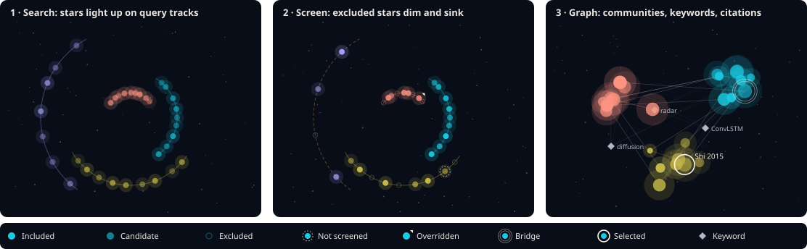

# Question runs: star-map visual language

Status: agreed on 2026-10-22. This document fixes how the question-run map looks
and moves in 2D and 3D, so that both views are built to one specification.
What happens when, and which actions exist, is in
[hsi-flow.md](hsi-flow.md); the graph data is `question_graph@1` in
[`docs/contracts/question/`](../contracts/question/).

The 2D view uses Sigma.js with graphology and is the default working view:
filtering, overriding and large graphs. The 3D view uses 3d-force-graph and
is for browsing and presenting. Both start from the Graph2D and Graph3D
components of the xingsuo project and share one store for data, selection,
filters and overrides; only the camera is per view.

## 1. Encoding

### 1.1 Papers are stars

| Channel | Encodes | Mapping |
| --- | --- | --- |
| Brightness (core opacity and glow radius) | Citation count | `b = 0.45 + 0.55 · log10(1 + c) / log10(1 + c_max)`, `c_max` over the run's candidates; repeat hits add `+0.06` each, capped at `+0.18` |
| Size | PageRank in the built graph | Before the graph exists: citations, `2.5 + 3.5 · log10(1+c)/log10(1+cmax)` px (2D) / units (3D), and a flat 2.5 for excluded stars, so the background stays quiet. After: `4 + 10 · sqrt(pr / pr_max)` px, so the smallest star stays clickable (≥ 8 px hit area) |
| Hue | Source query, then community | Before the graph: the color of the query that found it first. After: its community color (section 2). The change is animated (section 3) |
| Shape / fill | Screening state | See table 1.2; state never relies on color alone |
| Outer ring | Graph role | Hub: one thin ring. Bridge paper: a double ring. Selected: a 2 px `--sky-mark` ring that is always drawn on top |

### 1.2 Screening states

| State | Fill | Outline | Brightness | Labels | Position |
| --- | --- | --- | --- | --- | --- |
| Candidate (found, not judged yet) | Filled | None | 70 % of `b` | Hidden | On its query's track |
| Included | Filled | None | `b` | Level of detail rules (section 4) | Track, then layout |
| Excluded | Hollow | 1 px, desaturated hue | 25 % | Hidden unless selected | Sinks: drawn under the others in 2D; moves 40 units away from the camera in 3D |
| Unscreened (batch failed) | Filled | Dashed ring | `b` | As included | As included |
| Overridden | As its new state | A small `--sky-mark` notch at the top right | As its new state | As its new state | As its new state |

Excluded stars stay selectable and can be shown at full brightness with the
"Show excluded" filter, so that they can be found again.

### 1.3 Keywords and edges

| Element | Look |
| --- | --- |
| Keyword node | A small diamond, 3–7 px by the number of included papers that carry it; neutral color (`--sky-keyword`); label at medium zoom |
| Citation edge (`cites`) | Directed: a small arrowhead at the cited paper in 2D, a slow particle from citing to cited in 3D; color of the citing paper's community at 30 % opacity; width 0.6 px |
| Paper–keyword edge (`has_keyword`) | Undirected, 0.3 px, neutral, 10 % opacity; hidden below a zoom threshold |
| Derived edges (`co_citation`, `coupling`, `keyword_cooccur`) | Off by default; each can be turned on in the edge filter; dotted, width by weight |
| Edges of excluded stars | Not drawn unless "Show excluded" is on |

On hover, the star and its neighbours keep full opacity and everything else
drops to 8 %, as in xingsuo's Graph2D.

## 2. Color

The map canvas is always a night sky; the panels around it follow the
app theme (dark or light). This keeps one set of star colors legible in
both themes and is what makes the map read as a sky.

| Token | Value | Use |
| --- | --- | --- |
| `--sky-bg` | `oklch(.16 .025 265)` | Canvas background |
| `--sky-dust` | `oklch(.85 .02 85 / .35)` | Background star field (3D) and faint dots (2D) |
| `--sky-keyword` | `oklch(.78 .02 250)` | Keyword diamonds |
| `--sky-edge` | `oklch(.75 .02 250)` | Neutral edges before opacity |
| `--sky-label` | `oklch(.93 .01 90)` | Labels, with a 2 px `--sky-bg` halo |
| `--sky-mark` | `oklch(.97 .01 90)` | Selection ring (2 px) and override notch; near-white so it never matches a community hue |

Communities and queries share one categorical palette of 10 hues tuned for
the dark canvas (lightness 0.72–0.82, chroma 0.11–0.15, hues spaced about
36° apart starting at 30°), handed out in the order 0, 5, 2, 7, 4, 9, 1, 6, 3, 8
so that the first few queries or communities never get neighbouring hues. Communities beyond the ninth largest share
`--sky-other` (`oklch(.62 .02 250)`), and the legend says so. Every label and
the arrowheads keep at least 4.5 : 1 contrast against `--sky-bg`; star
colors keep at least 3 : 1.

## 3. Motion

| Moment | What moves | Duration | Easing |
| --- | --- | --- | --- |
| A query starts | Its track arc draws from one end | 400 ms | ease-out |
| Hit (new star) | Opacity 0 → `b`, size 1.6× → 1× flare | 600 ms | ease-out |
| Repeat hit | Brightness step and one pulse (1.25× → 1×) | 300 ms | ease-out |
| Verdict: included | Brightness 70 % → 100 % | 250 ms | ease-out |
| Verdict: excluded | Fade to 25 %, fill empties, sinks | 600 ms | ease-in |
| Override | Same as the verdict it sets, plus the notch pops in | 250–600 ms | as above |
| Expansion | The new star leaves its parent and travels to its place, trailing a fading line | 800 ms | ease-out |
| Graph forms | Stars move from the tracks to the force layout; hues cross-fade query → community; edges fade in | 1,500 ms move, 800 ms color, edges after 1,000 ms | ease-in-out |
| Switch 2D ↔ 3D | Cross-fade between the views | 300 ms | linear |

Hit bursts are rate-limited: at most 30 new stars start their flare per
second; extra hits in the same second appear together with one shared
fade. Animations never delay the data: the store is updated at once and the
animation only catches the picture up.

Before the graph exists, the run is drawn as a spiral galaxy. Each query is
an arm that leaves a shared core and winds out (2.4 rad from core to tip);
the arms sit evenly around the core in plan order, and a higher priority
makes a longer arm. A hit sits on its arm by rank, rank 1 by the core, with a
deterministic scatter across an arm that widens towards its tip. An arm
spreads over the highest rank its query has returned so far (at least 20).
A paper several queries found sits between their arms, pulled towards the
core by `1 / (1 + 0.45 · (n − 1))`, so the core gathers the papers the
queries agree on and glows softly. A failed query's arm is traced with a
dashed amber line. The
layout after the graph starts from these positions, so stars move as little
as possible.

**Atmosphere and focus** (2D):

- Each query's arm is a trail of faint nebula in its hue; included stars carry
  a soft halo that grows with citations (the 160 brightest, drawn behind the
  stars with additive blending). A second, sparser dust layer twinkles slowly.
- Hovering a query card in the flow, or a star, focuses that query: its
  arm brightens, every other star sinks to 18 % into the sky, and
  its nine most cited included papers are joined by a dotted constellation.
- The selected star carries a ring that breathes outwards every 1.8 s.
- The map is drawn with opaque colors only: a translucent color is mixed
  into `--sky-bg` first, because the WebGL blend adds a color's brightness
  whatever its alpha. A hollow star's fill is the sky.

**Reduced motion** (`prefers-reduced-motion: reduce`): every change above
becomes a 150 ms opacity fade; no flares, pulses, travel, particles or
camera flights; the graph appears in its final layout.

## 4. Labels and level of detail

Labels follow xingsuo's thinning rules: the selected star, hubs, bridges and
highly cited papers keep labels when zoomed out; other labels appear as the
camera gets closer. Only the selected star forces its label; the rest go
through the renderer's label grid, biggest stars first, so labels never
overlap. Paper labels are the short title (first author + year when the
title is longer than 28 characters); keyword labels are the keyword.

## 5. 2D and 3D

| | 2D (Sigma.js) | 3D (3d-force-graph) |
| --- | --- | --- |
| Role | Default working view | Browsing and presenting |
| Layout | ForceAtlas2 in a web worker, seeded by community, stopped after convergence | d3-force in 3D |
| Shapes | Circles with border program; diamonds for keywords | Glow sprites; octahedra for keywords |
| Hollow (excluded) | Border-only node | Sprite at 25 % with a ring texture |
| Large graphs | Budget below | Above 1,000 nodes a banner suggests 2D; nothing switches by itself |

The view switch is one toggle in the map toolbar. Selection, filters,
overrides and the open drawer survive the switch.

## 6. Legend, empty, loading and error

- **Legend** (a row under the map): brightness = citations, size =
  PageRank, hue = query or community (with names), the five screening
  states with their shapes, the three edge kinds.
- **Empty**: the night sky with a sparse dust field and the question box in
  the middle; no fake stars.
- **Loading** (queued or planning): the dust field slowly brightens; the
  plan card shows a skeleton. Under reduced motion it stays still.
- **Reconnecting**: a thin banner above the map; the map keeps its last
  state and does not clear.
- **Error**: failed query tracks are drawn dashed in `--warn`, with a
  marker that opens the failure; a fatal error dims the map to 50 % and
  shows the message over it.

## 7. Performance budget and checks

| Check | Data | Pass |
| --- | --- | --- |
| 2D first render | 2,000 nodes, 10,000 edges | Interactive within 2 s after the graph snapshot is loaded |
| 2D pan and zoom | Same | Median frame time ≤ 33 ms over a 3 s scripted pan and zoom |
| 2D hover | Same | Neighbour highlight within 100 ms |
| Search animation | 300 hits in 10 s | No dropped events; star count in the map equals hit events minus repeats |
| 3D warning | 1,001 nodes | The "switch to 2D" banner is shown |
| Reduced motion | Any | No animation longer than 150 ms runs |

The browser tests run these checks with recorded data in Chromium. Timing
limits apply on the reference workstation; in CI, where WebGL is
software-rendered, the frame-time limit is relaxed to 100 ms and the other
checks are unchanged.

## 8. The graph on the map, as built (#55)

Once the run's graph is read (`GET /graph?form=compact`), the map switches to
it (`frontend/src/question/map/graphScene.ts`, `layout.ts`); stars travel from
the spiral to their places over 1.5 s and the edges follow. What differs from
the plan above, and why:

- **Layout: one disc per community, packed.** A single ForceAtlas2 run over
  the whole graph folded the demo run's five communities into one ball (its
  papers cite across communities freely), which is what #113 called
  unreadable. Each community is now laid out on its own by ForceAtlas2 over its
  inner edges, its nodes spread evenly over a disc whose area grows with its
  papers (each node keeps its direction and its rank by distance from the
  centre), and the discs are packed around the largest one on a sunflower
  spiral. The same graph gives the same layout; 2,000 nodes and 10,000 edges take about
  0.25 s (`layout.test.ts`).
- **Citations between communities are summed.** Drawn one by one they fanned
  over the gaps and hid their direction. Each ordered pair of communities gets
  one curved arrow from nebula to nebula, as wide as the log of its count and
  labelled with it (A→B and B→A bend to opposite sides); the single citations
  stay as faint threads and light up when one of their ends is hovered.
  Citations inside a community are drawn as before.
- **Colours: the graph card's.** Communities take the Tableau 10 colours the
  graph card uses (`graph/palette.ts`), so a community reads the same in both;
  each keeps at least 3 : 1 against the sky. With more than ten communities
  the colours repeat, and the legend says so. Each community is a soft nebula
  in its colour with its label above it.
- **Keywords are small rings**, not diamonds: sigma has no diamond program in
  the packages we carry. Derived edges are thin solid lines, not dotted.
- **Size** is `2 + 5.5 · √(pr / pr_max)` px, smaller than section 1.1 says, so
  dense communities do not merge into blobs; hubs (top 5 % by PageRank) carry
  one ring and bridges two.
- **Filters are shared.** The graph card's filter (exclude/focus words,
  communities, years) also prunes the map: a paper it drops leaves the map,
  and a keyword stays while a shown paper carries it. The map adds the edge
  kinds (citations and keywords on, the three similarity kinds off) and
  "Show excluded", which puts the papers outside the graph on a rim. The
  camera frames the graph; the rim joins the frame only with "Show excluded".
  The legend lists the communities the filter shows.
- **Hover** lights the node, its neighbours over the drawn edges and only its
  edges; the rest sinks, and the community arrows step aside. A keyword's tip
  counts the shown papers that carry it. **Search** (the box over the map)
  selects a shown paper or keyword whose title or label holds the words and
  flies the camera to it; Enter again moves on to the next match. A miss is
  announced in a status line that is always mounted.

Not done here: the 3D view (#56, later), and the pan/zoom frame-time and
hover-latency checks of section 7, which need a GPU browser rather than the
software WebGL of the evidence runs.
